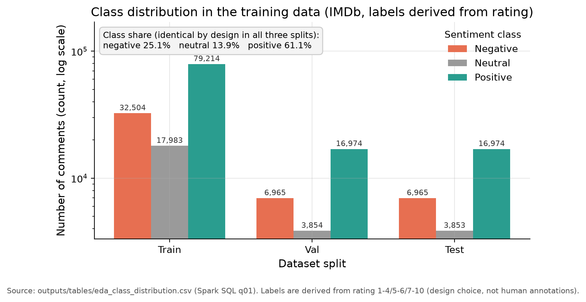
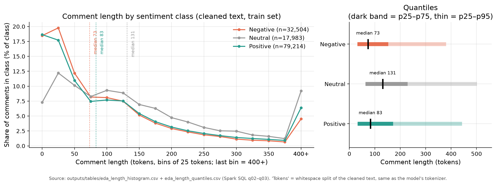
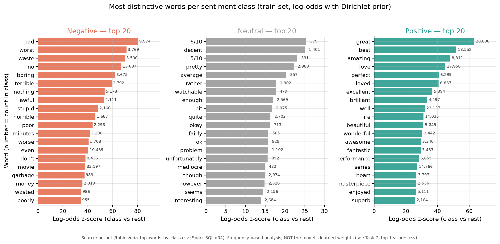
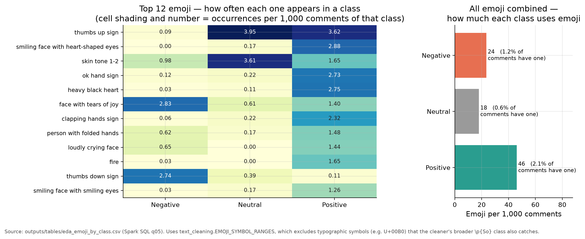
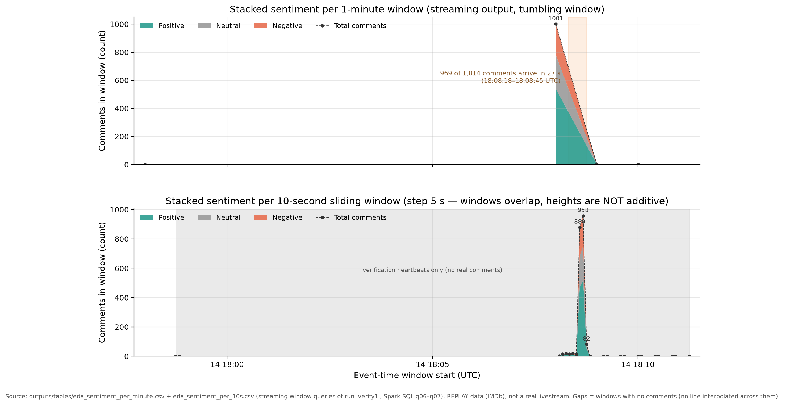
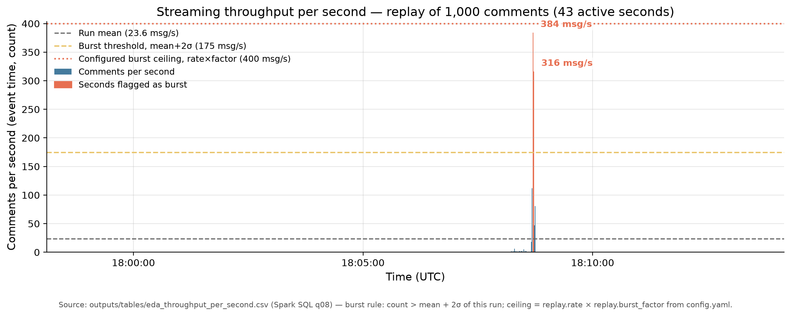
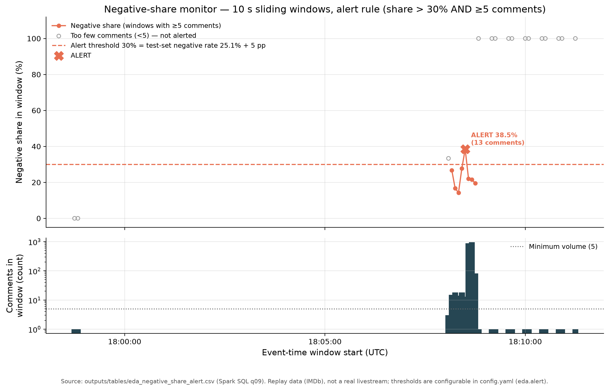
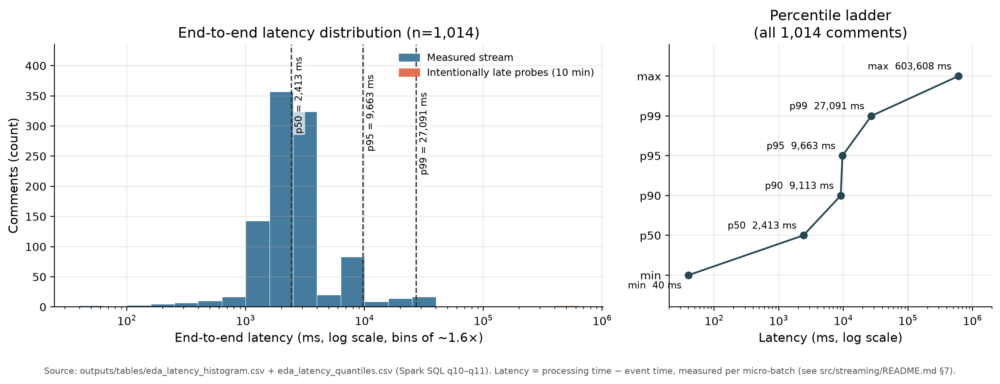
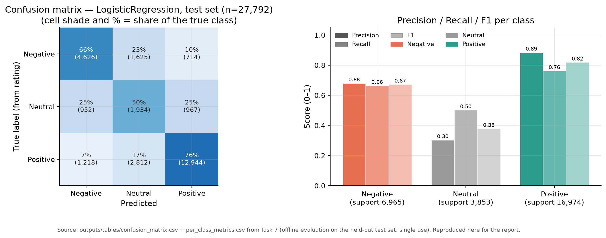

# outputs/insights.md — Insight và hành động (Task 9)

Sinh tự động ngày **15/10/2026** bởi `src/eda/plots.py` từ các bảng trong `outputs/tables/eda_*.csv` (do `src/eda/queries.py` chạy Spark SQL ghi ra). **Không có con số nào trong file này được viết tay.**

Phạm vi số liệu:
- Dữ liệu huấn luyện: **129,701 train / 27,793 val / 27,792 test** (IMDb Review Dataset - ebD, CC0, lấy mẫu 20% — xem `docs/data_dictionary.md`).
- Đầu ra streaming: lần chạy `verify1`, **1,014 bình luận** (1,000 phát lại + 14 bản ghi kiểm chứng), 2026-10-14 17:58:51.205 → 2026-10-14 18:13:26.434 UTC.
- ⚠️ **Dữ liệu streaming là REPLAY (phát lại review IMDb), KHÔNG phải bình luận livestream thật.** Mọi kết luận về hành vi người xem chỉ là minh hoạ cho cơ chế, phải đo lại khi có dữ liệu thật.

---

## 6. Class distribution of the training data

**Insight**

- Lớp **positive chiếm 61.1%** (79,214 bình luận), **negative 25.1%** và **neutral chỉ 13.9%** — dữ liệu mất cân bằng rõ rệt.
- Tỷ lệ ba lớp **giống hệt nhau ở cả train/val/test** (chênh dưới 0.02 điểm phần trăm) vì bước chia tập dùng thuật toán cân bằng theo nhóm phim (Task 6).

**Hành động**: Khi lập kế hoạch kiểm duyệt, đừng chia đều nguồn lực cho ba lớp và **đừng dùng accuracy** làm chỉ tiêu: đoán bừa "positive" đã đúng 61%. Theo dõi bằng F1 từng lớp.

*Bảng số liệu nền: `outputs/tables/eda_class_distribution.csv`*

---

## 7. Comment length by sentiment class

**Insight**

- Bình luận **neutral dài nhất** (trung vị 131 token, p95 501) — dài gấp **1.6×** so với positive (83 token). Negative ở giữa (73 token).
- Phân bố lệch phải mạnh ở cả ba lớp: 25% bình luận ngắn dưới ~32 token, nhưng 5% dài trên ~380–500 token — chất lượng thông tin trong một bình luận chênh nhau hàng chục lần.

**Hành động**: Nếu mỗi ngày chỉ đọc tay được một số lượng hữu hạn, **ưu tiên bình luận dài (> 300 token)**: đây đúng là nhóm mà mô hình yếu nhất (F1 lớp neutral chỉ 0.378 ở hình 14) và cũng là nhóm có nhiều ngữ cảnh nhất để người kiểm duyệt ra quyết định.

*Bảng số liệu nền: `outputs/tables/eda_length_histogram.csv`*

---

## 8. Top 20 distinctive words per sentiment class

**Insight**

- Từ đặc trưng nhất: negative **"bad"** (z=80.4), neutral **"6/10"** (z=25.3), positive **"great"** (z=63.1).
- Điểm đáng lo: **2 trong 20 từ đặc trưng nhất của lớp neutral là điểm số dạng "x/10"** (ví dụ "6/10"). Mô hình đang học *con số trong bài*, không phải cảm xúc — đúng như cảnh báo ở outputs/modeling_summary.md §5.

**Hành động**: Trước khi dùng cho livestream thật (bình luận không có điểm số), hãy coi **chỉ số 0.63 macro-F1 là mức trần lạc quan**; cần thu 200–300 bình luận thật có gán nhãn tay để đo lại trước khi tin.

*Bảng số liệu nền: `outputs/tables/eda_top_words_by_class.csv`*

---

## 9. Emoji usage by sentiment class

**Insight**

- Lớp positive dùng emoji **nhiều gấp 2.6×** lớp neutral (46 so với 18 emoji trên 1.000 bình luận; 2.1% bình luận positive có emoji). Nhưng mức dùng tuyệt đối vẫn rất thấp — emoji **không phải** tín hiệu đủ mạnh.
- Emoji đứng đầu lớp **negative lại là "face with tears of joy"**: 2.83 lần trên 1.000 bình luận negative, so với 1.40 ở positive (hạng 1 trong lớp). Cùng nhóm đó, "thumbs down sign" xuất hiện 2.74 lần/1.000 bình luận negative nhưng chỉ 0.11 ở positive. Vậy "cười" **không** đồng nghĩa "tích cực".

**Hành động**: **Đừng dùng emoji làm quy tắc cảm xúc** (ví dụ "có 😂 thì là tích cực") — dữ liệu nói ngược lại. Nếu dashboard có ô đếm emoji thì để cạnh chỉ số cảm xúc, không thay thế nó.

*Bảng số liệu nền: `outputs/tables/eda_emoji_by_class.csv`*

---

## 10. Sentiment over time (streaming output)

**Insight**

- Cửa sổ 1 phút chỉ có **4 điểm dữ liệu**: đợt phát dồn vào **một phút duy nhất** (total 1001 bình luận, positive 53.9% / neutral 24.2% / negative 21.9%); **969/1,014 bình luận đến trong 27 giây** (18:08:18–18:08:45 UTC). Vì vậy phải xem thêm khung cửa sổ trượt 10 giây mới thấy diễn biến bên trong.
- Trong cửa sổ 10 giây, tỷ lệ tiêu cực dao động **14.3% – 38.5%** giữa các cửa sổ (đỉnh 958 bình luận/cửa sổ); 14 cửa sổ chỉ chứa bản ghi nhịp tim kiểm chứng — tỷ lệ ở đó không có ý nghĩa.

**Hành động**: Trong livestream thật, đừng chờ hết phút mới nhìn: dùng **cửa sổ trượt 10 giây** để bắt đà tăng của tỷ lệ tiêu cực trong lúc sự việc đang diễn ra (xem quy tắc cảnh báo ở hình 12).

*Bảng số liệu nền: `outputs/tables/eda_sentiment_per_minute.csv`*

---

## 11. Throughput per second and burst detection

**Insight**

- Chỉ **2 trong 43 giây có dữ liệu** vượt ngưỡng bùng nổ (175 msg/s): 18:08:42 UTC với 384 msg/s và 18:08:43 UTC với 316 msg/s.
- Đỉnh đo được **384 msg/s = 96% trần thiết kế** (rate 50 × burst_factor 8 = 400 msg/s trong config.yaml) — bộ phát replay chạy đúng thiết kế, và đây cũng là mức tải lớn nhất hệ thống đã thực sự chịu.

**Hành động**: Đặt **cảnh báo hạ tầng ở mức 400 msg/s** (trần thiết kế): vượt mức đó là bộ phát/hệ thống đã ra khỏi vùng đã đo, cần kiểm tra `numInputRows` và độ trễ thay vì tin rằng mọi thứ vẫn ổn.

*Bảng số liệu nền: `outputs/tables/eda_throughput_per_second.csv`*

---

## 12. Negative-share monitor with alerting

**Insight**

- Quy tắc cảnh báo (tỷ lệ tiêu cực > 30% **và** ≥5 bình luận) bắn đúng **1 lần**: 18:08:30 UTC với 38.5% (13 bình luận) — đó là đỉnh tiêu cực thật của đợt bùng nổ.
- Nếu **bỏ điều kiện đủ 5 bình luận**, sẽ có thêm **13 báo động giả** (cửa sổ 1–3 bình luận cho tỷ lệ 33–100%) — đúng như đã thấy ở Task 8 với các bản ghi nhịp tim đơn lẻ.

**Hành động**: Đưa đúng quy tắc này vào dashboard: **cửa sổ 10 giây, cảnh báo khi tỷ lệ tiêu cực > 30% và số bình luận ≥ 5**, kèm hiển thị số bình luận trong cửa sổ để người trực biết mức tin cậy.

*Bảng số liệu nền: `outputs/tables/eda_negative_share_alert.csv`*

---

## 13. End-to-end latency distribution

**Insight**

- Phân bố **hai đỉnh**: **824/1,014 bình luận (81%) được chấm trong 1.0–4.0 giây** (p50 = 2,413 ms), nhưng có một nhóm thứ hai đúng **83 bình luận ở 6.3–10.0 giây**. p95 = 9,663 ms, p99 = 27,091 ms.
- Đuôi dài **không** đến từ chặng Kafka (kafka p50 = 0 ms, p95 = 1 ms) mà từ **hàng đợi xử lý trong micro-batch**: queue p50 = 2,355 ms, p95 = 9,136 ms — bình luận dồn về đúng lúc bùng nổ. Hai bản ghi cố tình đẩy trễ 10 phút nằm ở cột ngoài cùng bên phải (603 giây).

**Hành động**: Nếu livestream cần hiển thị cảm xúc tức thì, **hạ trigger từ 5 s xuống 1–2 s** hoặc tăng song song: hiện p95 đã là 9.7 s, quá chậm cho phản hồi trong lúc đang phát.

*Bảng số liệu nền: `outputs/tables/eda_latency_histogram.csv`*

---

## 14. Model quality (offline, from Task 7)

**Insight**

- Trên tập test, mô hình LogisticRegression đạt **F1: negative 0.67 — neutral 0.38 — positive 0.82** (accuracy 0.702).
- Lớp neutral là điểm yếu nhất: chỉ **50%** bình luận neutral được đoán đúng, 25% bị đoán nhầm thành positive — phù hợp với kết luận "nhãn neutral suy từ rating 5–6 là nhãn nhiễu" (docs/data_dictionary.md §3).

**Hành động**: Với các bình luận mô hình gán **neutral**, hãy để người kiểm duyệt xem lại (độ tin cậy thấp), và **không dùng ngưỡng cảm xúc chung cho cả ba lớp** vì chất lượng mỗi lớp chênh nhau gần 0.44 F1.

*Bảng số liệu nền: `outputs/tables/eda_model_quality.csv`, `outputs/tables/per_class_metrics.csv`, `outputs/tables/confusion_matrix.csv`*

---

## 15. Interactive sentiment timeline (optional, HTML)

**[Mở biểu đồ tương tác](figures/15_sentiment_timeline.html)** (file HTML tự chứa, mở bằng trình duyệt)

**Insight**

- Bản tương tác của hình 10: rê chuột để xem từng cửa sổ 10 giây (số bình luận mỗi lớp + tổng), dùng khi thuyết trình để soi đúng khoảng thời gian đang nói tới.

**Hành động**: Mở file này ngay trên máy khi demo (tự chứa plotly.js nên **không cần mạng**).

---

## Tổng hợp: điều số liệu ủng hộ và điều KHÔNG

- **Ủng hộ**: mô hình chạy được theo luồng — **1,014 bản ghi được chấm điểm tức thời**, F1 lớp positive trên luồng 0.81 (hình 14 cho thấy đây vẫn là lớp mạnh nhất, giống hệt đánh giá offline).
- **KHÔNG ủng hộ**: bước tách từ còn thô — **11.2%** lượt token có dấu câu dính ở hai đầu ("movie." bị coi là từ khác "movie"), làm từ vựng phình từ 318,980 lên **524,107 từ** (+64%). Chưa sửa ở Task 9 vì sửa là phải huấn luyện lại mô hình mới so sánh được (xem `outputs/tables/eda_token_vocab.csv`).
- **KHÔNG ủng hộ**: emoji **không đủ mạnh để làm đặc trưng cảm xúc** — ngay ở lớp dùng nhiều nhất (positive) cũng chỉ 46 emoji/1.000 bình luận (2.1% bình luận có emoji); và emoji đứng đầu lớp negative lại là "face with tears of joy" (92 lần) — dấu hiệu mỉa mai, không phải tích cực.
- **Chưa kiểm chứng**: hành vi với **bình luận livestream thật** (tiếng Việt, teencode, không có điểm số), với **tải cao hơn** (mức cao nhất đã đo là 384 msg/s) và **exactly-once** khi job chết giữa chừng (xem `src/streaming/README.md` §11) — tất cả đều **cần kiểm chứng**, không được suy diễn từ số liệu trên.

---

**Nguồn số liệu**: `outputs/tables/eda_*.csv`, `class_distribution.csv`, `per_class_metrics.csv`, `confusion_matrix.csv`, `stream_per_class_metrics.csv`. SQL nguyên văn: `src/eda/sql/*.sql`. Sinh lại: `$VENV_PY src/eda/plots.py`.
